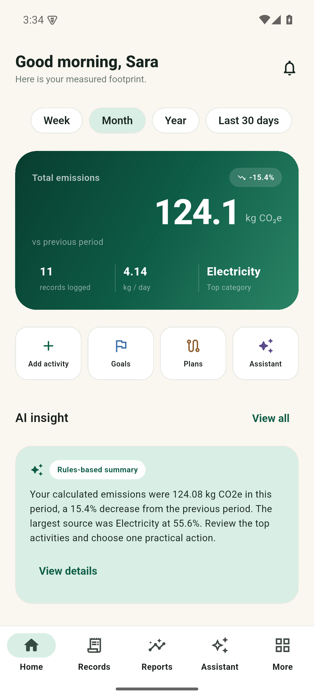
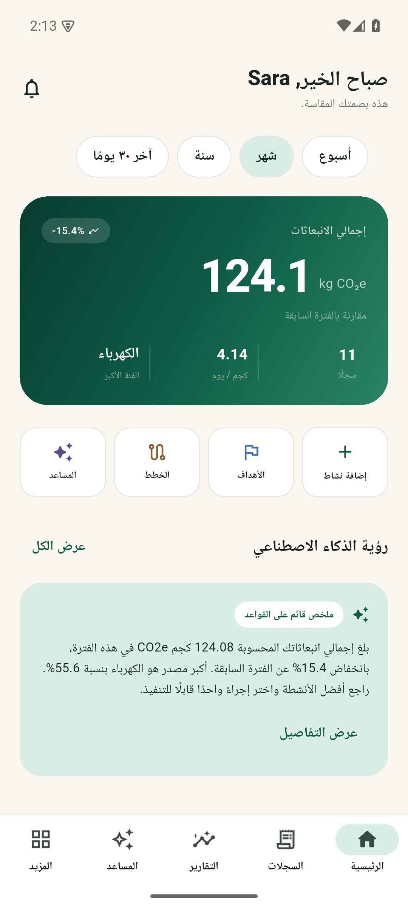
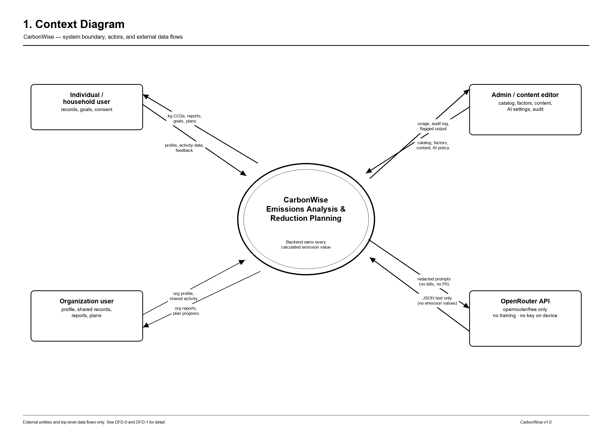

# CarbonWise · كربونوايز

**AI-powered emissions analysis and sustainable reduction planning.**

CarbonWise is a final-year, full-stack demo: a Flutter Android app for individuals and
organization users, a Flask JSON API, a Jinja admin dashboard, and a guarded AI layer.
Every emission number is calculated by the backend from versioned emission factors; the
AI only explains, summarises, and recommends. It never invents or changes a calculated value.

[](https://github.com/Asmaaebraheem1/G_81/actions/workflows/backend.yml)
[](https://github.com/Asmaaebraheem1/G_81/actions/workflows/mobile.yml)




## What it does

| Area | Capabilities |
|---|---|
| Accounts | Register/login, JWT access + rotating refresh tokens, profiles, organization accounts, EN/AR + RTL |
| Activity | Log electricity, transport, flights, food, water, waste and shopping; bill uploads with optional AI extraction |
| Calculation | Integer grams CO2e from active factors, immutable factor snapshots, monthly/period reports and CSV export |
| Planning | Sustainability goals with baselines, reduction plans with backend-estimated savings, curated alternatives |
| Engagement | Challenges, points, badges, private opt-in leaderboard, notifications and reminders |
| AI | Grounded assistant, insights, summaries, and plan narratives via OpenRouter `openrouter/free`; deterministic fallback when no key |
| Admin | Separate cookie + CSRF console for users, organizations, catalog/factors, records, documents, content, challenges, AI monitor, audit and settings |

The demo timeline is fixed at **2026-06-30** so seeded reports and screenshots are
reproducible.

## Stack and boundaries

- **Mobile:** Flutter (stable) · BLoC/Cubit · Dio · sqflite read cache · go_router.
- **Backend:** Flask 3 · flask-openapi3 · SQLAlchemy 2 · Alembic · SQLite only.
- **Admin:** Jinja2 · Flask-WTF CSRF · signed session cookie · `super_admin` / `content_editor`.
- **AI:** OpenRouter server-side only, model enforced to `openrouter/free`; no model training,
  no key in the app, no prompt logging, PII redaction, structured JSON validation, and a
  no-numeric guard.
- **API contract:** `/api/v1` is JSON + JWT; `/admin` is HTML + cookie + CSRF. The two auth
  systems are never mixed.

## Quick start (Windows)

Prerequisites: Python 3.12+, Flutter stable, Android SDK/emulator for the mobile app.

### 1. Backend and admin

```cmd
cd backend
py -3 -m venv .venv
.venv\Scripts\pip install -r requirements.txt -r requirements-dev.txt
copy .env.example .env
.venv\Scripts\flask.exe --app app seed
.venv\Scripts\flask.exe --app app run --host 127.0.0.1 --port 5001
```

- API docs: <http://127.0.0.1:5001/api>
- Admin: <http://127.0.0.1:5001/admin/login>
- Health: <http://127.0.0.1:5001/api/v1/health>

Port **5001** is used because 5000 is commonly occupied on the development machine.
Set `OPENROUTER_API_KEY` in `backend/.env` to enable live AI; leave it blank for the
deterministic fallback mode used in CI and demos.

Or use `scripts\demo.cmd`, which seeds if needed, starts the server, opens the admin
login, and prints the accounts and mobile command.

### 2. Mobile app

```cmd
cd mobile
flutter pub get
flutter run --dart-define=API_BASE_URL=http://10.0.2.2:5001/api/v1
```

`10.0.2.2` is the Android emulator's alias for the host machine. For a physical device,
use the host's LAN IP and start Flask with `--host 0.0.0.0`.

### Demo accounts

| Role | Email | Password |
|---|---|---|
| Individual user | `sara@carbonwise.demo` | `User123!` |
| Individual user | `ahmad@carbonwise.demo` | `User123!` |
| Organization user | `org@carbonwise.demo` | `Org123!` |
| Admin | `admin@carbonwise.demo` | `Admin123!` |
| Content editor | `editor@carbonwise.demo` | `Editor123!` |

## Verification

```cmd
cd backend
.venv\Scripts\ruff.exe check .
.venv\Scripts\black.exe --check .
.venv\Scripts\python.exe -m pytest --cov=app --cov-fail-under=50
```

```cmd
cd mobile
flutter analyze
flutter test --coverage
cd ..
backend\.venv\Scripts\python.exe scripts\check_lcov.py mobile\coverage\lcov.info --min 50
```

```cmd
scripts\smoke.cmd
```

Latest local results: backend **54 tests / 76%**, mobile **23 tests / 92.2%**, analyzer
**clean**, ruff/black clean. Coverage gates are **50%** on both sides and run in CI.

## Deliverables

| Deliverable | Location |
|---|---|
| Source code | `backend/`, `mobile/` |
| Documentation set | [`docs/README.md`](docs/README.md) |
| System diagrams (5, black & white, 300 DPI) | [`docs/diagrams/`](docs/diagrams/README.md) |
| Screenshot library (mobile EN + AR, admin) | [`docs/screenshots/`](docs/screenshots/README.md) |
| Visual assets and credits (15 original WebP) | [`docs/assets/`](docs/assets/README.md), [`credits.md`](docs/assets/credits.md) |
| AI vs backend ownership | [`docs/ai-features.md`](docs/ai-features.md) |
| Demo script | [`docs/demo-script.md`](docs/demo-script.md) |
| Feature specifications (F01–F15) | [`docs/features/`](docs/features/README.md) |
| API reference | [`docs/06-api-reference.md`](docs/06-api-reference.md) |
| Data model / ERD notes | [`docs/05-data-model.md`](docs/05-data-model.md) |
| Arabic project report (Word) | [`docs/reports/CarbonWise-Project-Report-AR.docx`](docs/reports/CarbonWise-Project-Report-AR.docx) |
| Arabic project-idea sheet (Word) | [`docs/reports/G_81-Project-Idea-AR.docx`](docs/reports/G_81-Project-Idea-AR.docx) |



## Repository map

```
backend/   Flask API, admin panel, models, migrations, tests
mobile/    Flutter app (EN/AR, RTL), BLoC, Dio, sqflite read cache
docs/      overview, architecture, API, data model, features, diagrams, screenshots, assets
scripts/   demo, smoke test, coverage gate, diagram wrapper
.pi/       agent skills and repository workflow
```

## Working rules

The project follows [`agent.md`](agent.md): one issue → one branch (`dev/<n>-<slug>`) →
one PR (`Closes #n`), documentation in the same PR, tests and coverage gates, no push to
`main`, and a strict separation between `/api/v1` and `/admin`. See
[`docs/workflow/process.md`](docs/workflow/process.md) for the full checklist.

## Credits

Original CarbonWise illustration set, generated by `docs/assets/generate_assets.py`,
released under CC BY 4.0; see [`docs/assets/credits.md`](docs/assets/credits.md).
Emission-factor sources and the calculation method are documented in
[`docs/02-configuration.md`](docs/02-configuration.md). Seeded factors draw on DEFRA/BEIS,
UK Water Industry, Poore & Nemecek/Our World in Data, WRAP and manufacturer LCA ranges;
EPA/IPCC informed the general methodology but are not claimed as certification.
